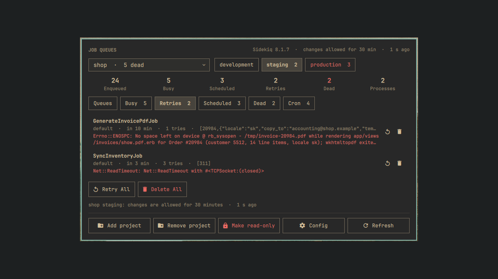
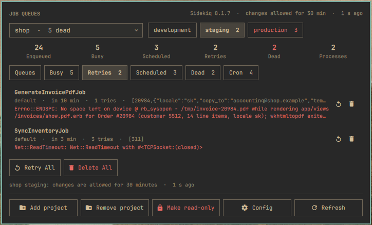
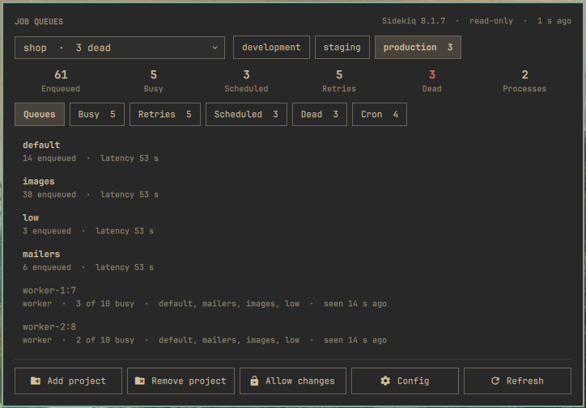
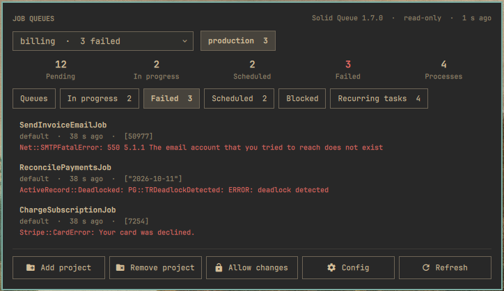
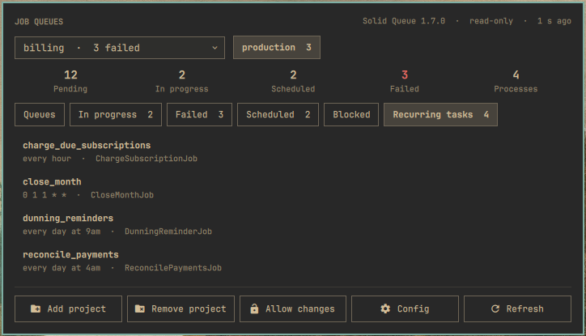
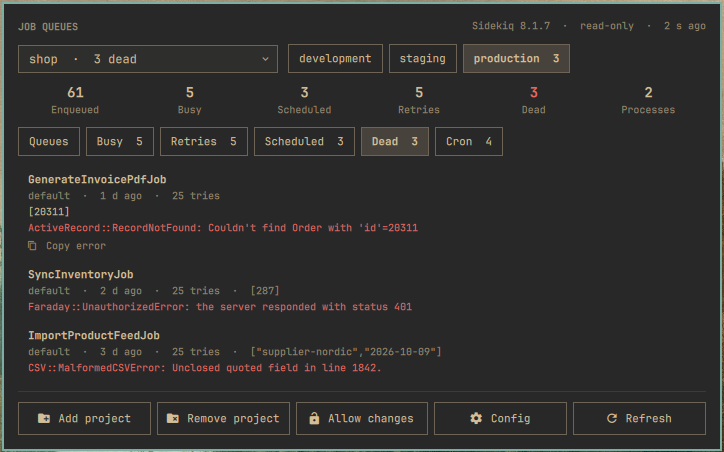
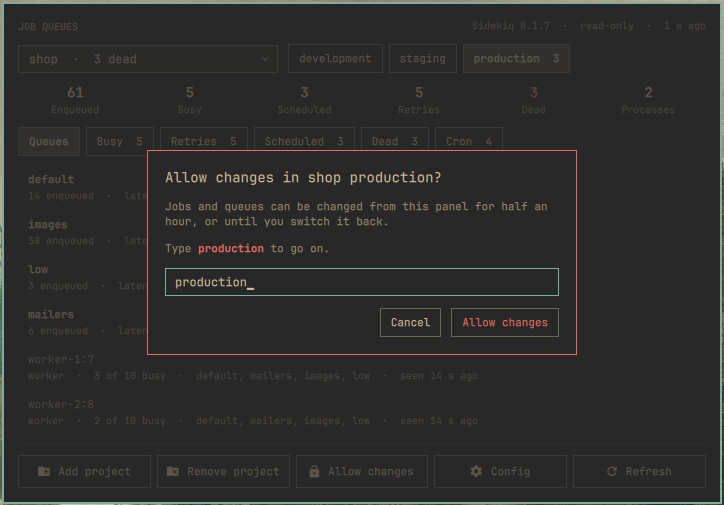
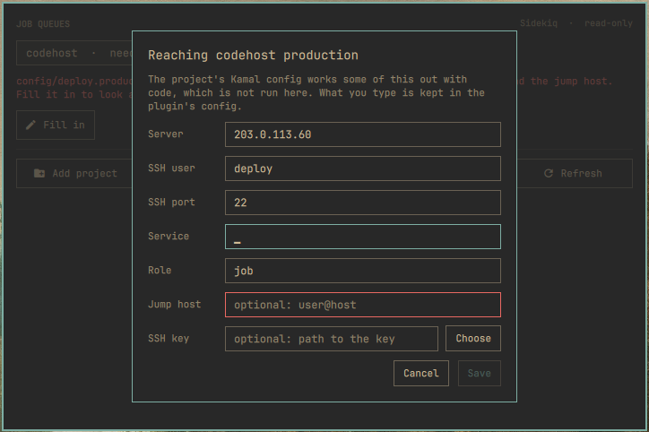

# Job Queues

An Omarchy plugin that shows the Sidekiq and Solid Queue of your Rails
applications in the bar: what is queued, running, failed, scheduled and
recurring on production and staging, with retry, delete, pause and run-now.



Nothing is added to the applications. For each environment the plugin opens an
SSH connection and pipes the scripts in `remote/` into `bin/rails runner -` inside
the running container; the script answers with one line of JSON and carries
out the changes asked for from the panel. Projects, their backends and their
environments are read from the projects' own files, so a move from Sidekiq to
Solid Queue, or a new staging server, needs no change here.

## Install

```
omarchy plugin add https://github.com/MaNi4/omarchy-job-queues.git --enable
```

Open the panel from the bar, press **Add project** and choose the directory of
a Rails application. Its environments are found in its Kamal config.

## Remove

```
omarchy plugin remove mani4.job-queues
```

Nothing of the plugin is on your servers, so there is nothing to remove there.
The list of your projects stays in `~/.config/omarchy/extensions/job-queues.json`;
delete that file if you do not want to keep it.

## Usage

- Click the icon for the panel; right-click to ask every server now. The
  servers are asked only then: when the panel opens, when you choose another
  project or environment, and on Refresh. The icon shows what the last look
  found: lit while a staging or production environment had failed jobs or
  could not be reached.
- At the top, the project (a list you can search in) and beside it the
  environments it runs in. A red number is the failed jobs behind a choice,
  `!` an environment that did not answer. Whether the project runs Sidekiq or
  Solid Queue is shown at the top right.
- **Add project** lists a project (you choose its directory), **Remove
  project** takes the chosen one off the list; neither touches the project
  itself.
- Then the numbers and the tabs, named as each gem's own interface names
  them. For Sidekiq, as in its web interface: **Queues** (with the
  processes), **Busy**, **Retries**, **Scheduled**, **Dead** and **Cron**
  (sidekiq-cron), with **Retry Now**, **Add to queue**, **Delete**, **Retry
  All**, **Delete All** and **Enqueue Now**. For Solid Queue, as in Mission
  Control: **Queues**, **In progress**, **Failed**, **Scheduled**, **Blocked**
  and **Recurring tasks**, with **Retry**, **Discard**, **Run now**, **Retry
  all**, **Discard all**, **Pause** and **Resume**.
- A job's arguments and error are cut short in the list. Click the job to
  unfold it and read them whole; **Copy error** under them puts the error on
  the clipboard.
- Everything is **read-only** until you allow changes for an environment;
  development, which is your own machine, is the exception. The **Allow
  changes** button at the bottom allows them for the environment you are
  looking at, for half an hour: it asks you to type the environment's name
  first. It then reads **Make read-only**, and a click does that at once; the
  top right corner says which of the two the environment is in. Where
  changes are allowed, each row has its actions at the right edge and the
  ones for a whole list appear under it. Anything that throws jobs away asks
  first, and in production every change does.
- Keyboard: up/down move, left/right change tab, Enter retries or runs, `x`
  deletes or discards, `o` unfolds a job, `y` copies its error, `p` opens the
  project list, `a` adds a project, `e` next environment, `r` refreshes, `c`
  opens the config, Esc closes.


## Screenshots

The pictures show made-up projects and jobs.

| Sidekiq, an environment where changes are allowed | Sidekiq, read-only production |
|---|---|
|  |  |

| Solid Queue, failed jobs | Solid Queue, recurring tasks |
|---|---|
|  |  |





## Projects

`~/.config/omarchy/extensions/job-queues.json` lists them; **Add project** and **Remove
project** edit it, and the **Config** button opens it (a missing file starts
as `job-queues.example.json`). Nothing is looked for on its own.

```json
{
  "projects": [
    { "path": "~/Projects/shop" }
  ]
}
```

A project's backend is the `sidekiq` or `solid_queue` in its `Gemfile.lock`,
and its environments come from the project too:

- **development** is the compose service that runs the jobs (else the app),
  entered with `docker compose exec`, so only while it is running. A project
  without a compose file has no development unless you give it one; nothing
  of a project is started on this machine unasked.
- **the others** are the Kamal destinations: one per `config/deploy.<name>.yml`
  merged over `config/deploy.yml`, or `production` when `deploy.yml` is the
  only one. The host, SSH user and port, service and the role that runs the
  jobs are read from there, and so are a jump host (`ssh.proxy`) and the
  keys to use (`ssh.keys`, `ssh.keys_only`).

So a project without a staging server has no staging, and one that gets a new
destination shows it within half a minute; `bin/job-queues --list` prints
what was found without connecting anywhere.

Kamal lets a config work its values out with code (ERB). That code is not run
here, so a server's address, SSH user, port, service, role, jump host or key
written that way cannot be read. The environment then says what it lacks, a notification says
so once, and **Fill in** asks for it; what you type is kept in the project's
entry and the rest is still read from the project. An environment that was
read whole but does not answer offers the same form as **Edit connection**,
for the case that what the project says is not how you reach it:



```json
{ "path": "~/Projects/shop",
  "environments": { "production": { "host": "203.0.113.60", "user": "deploy" } } }
```

A project is listed even when nothing was found to look at in it, with a note
saying what is missing. Anything else that needs saying by hand goes into its
entry:

```json
{ "name": "Shop", "path": "~/work/shop",
  "backends": ["solid_queue"], "role": "job",
  "development": false,
  "environments": {
    "staging": { "ssh": "deploy@203.0.113.8", "path": "/var/www/shop/current" },
    "demo": { "ssh": "deploy@203.0.113.9", "kamal": { "service": "shop", "role": "web" } } } }
```

| Key            | Meaning                                                                       |
|----------------|-------------------------------------------------------------------------------|
| `path`         | The project's directory; everything below is optional with it                 |
| `name`         | Label of the button, the directory's name by default                          |
| `backends`     | `sidekiq`, `solid_queue` or both, instead of what `Gemfile.lock` says         |
| `role`         | The Kamal role to enter, instead of the one that runs the jobs                |
| `runner`       | `rails` or `ruby`, instead of finding out (see below)                         |
| `development`  | `false` to leave it out, or an environment as below, e.g. `{ "command": "bin/rails runner -", "cwd": "~/work/shop" }` |
| `environments` | By name, added to or replacing what was found                                 |

An environment of a Kamal destination takes `host`, `user`, `port`, `service`,
`role`, `proxy` (the jump host, `user@host`) and `key` (a path), each
replacing what the project says. Kamal's `ssh.proxy_command` and `ssh.key_data`
are not taken over; the connection is made by your own `ssh`, so a `Host`
entry in `~/.ssh/config` or a key in the agent does the same. Any other is `ssh` (`user@host`, with `port`; without it the command runs
on this machine) and one of `kamal` (`{ "service", "role", "destination" }`),
`path` (the release directory of a deployment without containers) or `command`
(any shell command that reads Ruby on stdin, with `cwd`). The one named
`production`, or carrying `"production": true`, asks before every change.

Sidekiq only needs its gem and Redis, so it is asked with `bundle exec ruby -`
first, a fraction of the cost of booting the application. Where that does not
answer (no `REDIS_URL` in the container, Redis set up in an initializer) the
plugin falls back to `bin/rails runner -` and stays with it. Solid Queue needs
the application and always gets the latter: a few hundred MB for some seconds,
which is why nothing happens in the background by default. Failed jobs are better reported by the
application's error tracker, so the plugin sends no notifications. If you do
want the icon to follow failures on its own, add `"interval": 900` (seconds,
60 at least) to the config; a round then asks every environment of every
project.

## Read-only

For an environment that is not unlocked the panel has no actions, the feed
refuses a change asked for anyway, and the script sent to the server has the
code that could make one cut out of it: each backend's script in `remote/`
keeps everything that writes between two `changes` marks, and only a change
to an unlocked environment is sent with it. So looking cannot delete, retry or pause
anything, whatever goes wrong in the panel.

Where the application has a database (always with Solid Queue), the script
also reads inside `ActiveRecord::Base.while_preventing_writes`, so Rails
itself refuses any INSERT, UPDATE or DELETE while it looks. Sidekiq's data is
in Redis, which has nothing of the kind to ask for from the script.

A change to Solid Queue is fenced too: while it is carried out, every SQL
statement is looked at before it is sent, and one that writes to a table
other than `solid_queue_*`, or is not a plain read or write at all (`DROP`,
`TRUNCATE`, `ALTER`), is stopped with an error instead.

Unlocking is done from the panel and nowhere else: you type the
environment's name, and the feed keeps it writable for half an hour, in its
own memory only. Nothing about it is written to the config or to any other
file, so no edit can unlock one, and it ends with the half hour, with the
shell, when you click **Make read-only**, or when the environment's server or
container changes. A stray click or key does not get past the name.

The feed also carries the SHA-256 of each script in `remote/` it was written
with and sends nothing when one reads differently, so a script changed by
accident, or by something that did not know to change both, stays on this
machine. After changing one on purpose, put what
`bin/job-queues --checksum` prints into `REMOTE_SHA256` in the feed.

What this cannot cover is the machine itself: whoever can rewrite the
plugin's files, or use your SSH key, can do on the server what you can. That
is as true of `kamal` and plain `ssh`.

Nothing is left running on a server. What is started there gets 110 seconds:
from `timeout` where the container has one, and from the script itself, which
ends its own process when it has not answered by then. The feed waits 120
seconds before it gives up, and closing the connection alone would not end a
process inside a container.

SSH runs with `BatchMode=yes`, so the key has to work without a prompt (an
agent, or a key without a passphrase) and the host has to be in
`known_hosts`. The SSH user needs to be allowed to run `docker`, as Kamal
already requires.

## Backends

What is sent to a server is `remote/core.rb`, which holds what the backends
share, followed by the script of the one backend the project uses:
`remote/sidekiq.rb` or `remote/solid_queue.rb`. The other is not sent at all.

Another backend is a file of its own beside them, named after its gem
(`good_job.rb`): a module that answers to the handful of methods described at
the top of `core.rb`. The name is what is looked for in `Gemfile.lock`, and
what the panel shows it under ("Good Job"). The one thing to do besides is to
add the line `bin/job-queues --checksum` prints for it to `REMOTE_SHA256`
in the feed; a script that is not listed there is never sent.

## Requirements

What has to be true for the plugin to show an application's jobs. Where one
of these does not hold, the environment says so in the panel instead of
showing anything.

**The application**

- A Rails application whose jobs run on **Sidekiq** (7 and 8 were tried, with
  or without sidekiq-cron) or **Solid Queue** (1.7 was tried). Resque, Good
  Job, Delayed Job and the like are not supported.
- The gem is in its `Gemfile.lock`; that is how the backend is known.
- `bin/rails` works in the place the jobs run in, and there is a `sh` there.

**Production and staging**

- Deployed with **Kamal**: `config/deploy.yml`, with `config/deploy.<name>.yml`
  per destination if there are several. The host, SSH user and port, the
  service and the role are read from there. A deployment without Kamal works
  only when you describe the environment by hand (see Projects): a release
  directory on a server, or any command that reads Ruby on stdin.
- The container that runs the jobs is running, and Docker on the server
  labels it as Kamal does (`service`, `role`, `destination`). The role taken
  is the one whose command runs the jobs, else one named `job`, `jobs`,
  `worker`, `workers`, `sidekiq` or `solid_queue`, else `web`.
- You can `ssh` to the server from this machine **without being asked
  anything**: the key is in an agent or has no passphrase, and the host is in
  `known_hosts`. Passwords are not supported. A jump host (`ssh.proxy`) and
  keys (`ssh.keys`) from the Kamal config are used; `ssh.proxy_command` and
  `ssh.key_data` are not, but your own `~/.ssh/config` applies as always.
- The SSH user may run `docker`, as Kamal itself needs.
- For Sidekiq, Redis is reachable from the job container, which it is where
  Sidekiq runs. Where the container has `REDIS_URL`, a look takes about a
  second; where Redis is set up in an initializer, the application is booted
  for it, which takes as long as `bin/rails runner` does.
- For Solid Queue, the application is always booted, and its queue database
  has to be reachable from the job container.

**Development**

- The project has a compose file (`compose.yaml` and its other spellings)
  with a service that is built from the project, and that service is running.
  Without one there is no development environment unless you give it a
  command in the config.

**This machine**

- Omarchy with the Quickshell-based shell.
- `ssh`, and Python with PyYAML and PyGObject (`python-yaml`,
  `python-gobject`), all part of a stock Omarchy. `docker` only for
  development environments.

Nothing is installed on the servers and nothing is added to the application.

## Tests

`tests/run` runs them all: Python's `unittest` for the feed and Ruby's
Minitest for what is sent to the servers. They need nothing installed beyond
Python and Ruby, keep to a temporary directory instead of your config, and
connect nowhere. One of them fails when a script in `remote/` no longer
matches its checksum, so a change there cannot be forgotten.

## License

MIT
